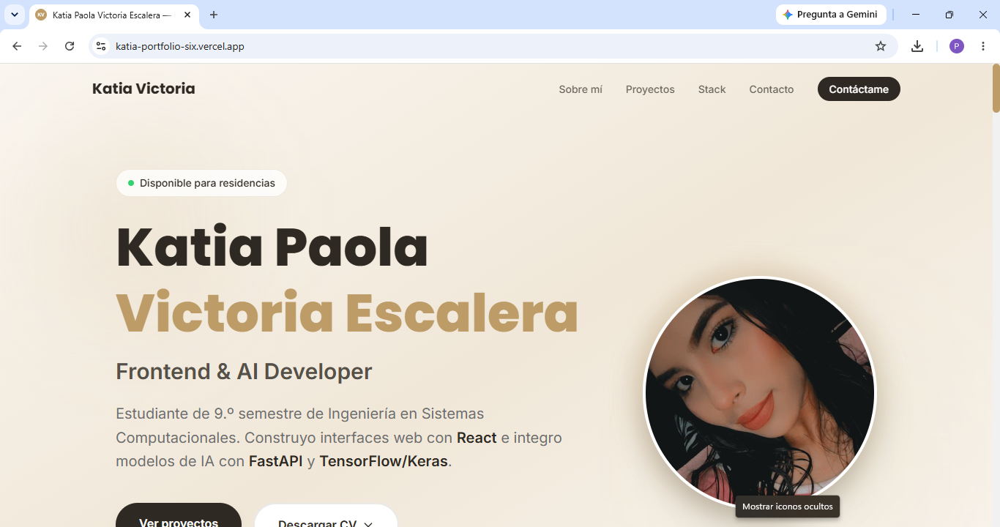
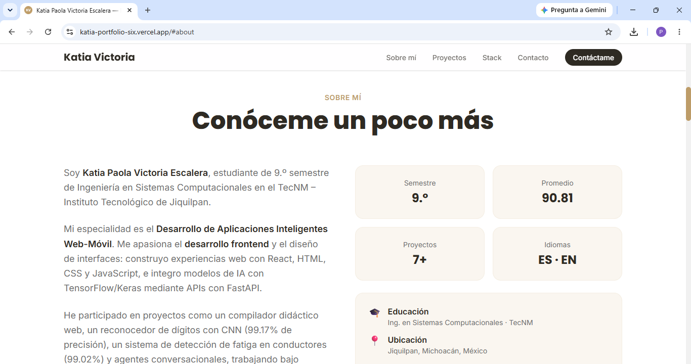
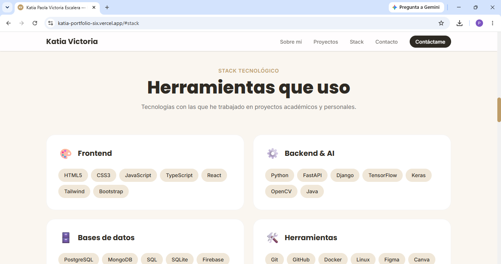
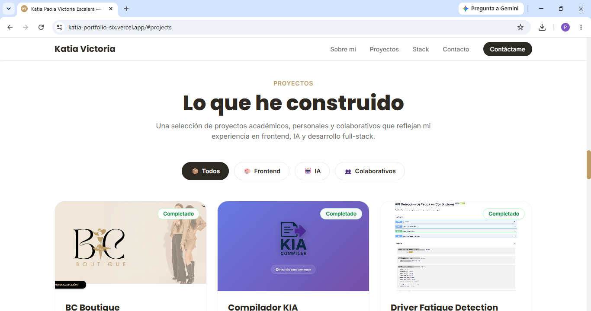
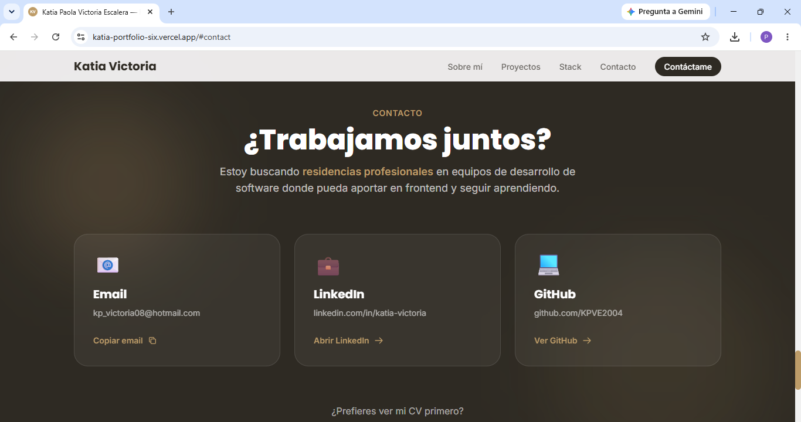

# Katia Victoria — Personal Portfolio

My personal portfolio website, built from scratch with **React**, **Vite**, and **Tailwind CSS**. It showcases my projects, technical skills, and provides an easy way to reach me.

🌐 **Live:** [katia-portfolio-six.vercel.app](https://katia-portfolio-six.vercel.app/)

---

## English

### About

A modern, single-page portfolio featuring:
- Bilingual-friendly sections in Spanish
- Responsive design (mobile-first)
- Custom color palette (cream + gold tones)
- Project filtering by category
- Downloadable CV (Spanish + English)
- Contact section with copy-to-clipboard email

### Features

- **Hero section** with profile photo, availability badge, and CV download menu.
- **About section** with personal summary, quick facts, and links.
- **Stack section** organized by category (Frontend, Backend & AI, Databases, Tools).
- **Projects section** with 7 project cards, category filters, real screenshots, and GitHub links.
- **Contact section** with 3 contact cards and CV download buttons.
- **Footer** with navigation, social links, and dynamic copyright year.
- **Custom favicon** with "KV" initials in a gold circle.

### Screenshots

**Hero**


**About**


**Stack**


**Projects**


**Contact**


### Tech Stack

| Layer | Technology |
| ----- | ---------- |
| Frontend | React 18, Vite |
| Styling | Tailwind CSS v4 |
| Fonts | Inter + Poppins (Google Fonts) |
| Icons | Inline SVG |
| Deploy | Vercel |

### Project structure

```
katia-portfolio/
├── public/
│   ├── favicon.svg
│   ├── CV-Katia-Victoria-ES.pdf
│   └── CV-Katia-Victoria-EN.pdf
├── src/
│   ├── assets/
│   │   ├── profile.jpg
│   │   └── projects/          # Project screenshots
│   ├── components/
│   │   ├── Navbar.jsx
│   │   ├── Footer.jsx
│   │   └── ProjectCard.jsx
│   ├── data/
│   │   ├── projects.js
│   │   └── stack.js
│   ├── sections/
│   │   ├── Hero.jsx
│   │   ├── About.jsx
│   │   ├── Stack.jsx
│   │   ├── Projects.jsx
│   │   └── Contact.jsx
│   ├── App.jsx
│   ├── index.css
│   └── main.jsx
├── index.html
├── package.json
├── tailwind.config.js
├── vite.config.js
└── vercel.json
```

### Deployment

The portfolio is automatically deployed to **Vercel** on every push to `main`.  
🌐 **Live:** [katia-portfolio-six.vercel.app](https://katia-portfolio-six.vercel.app/)

---

## Español

Mi portafolio personal, construido desde cero con **React**, **Vite** y **Tailwind CSS**. Muestra mis proyectos, habilidades técnicas y una forma fácil de contactarme.

🌐 **En vivo:** [katia-portfolio-six.vercel.app](https://katia-portfolio-six.vercel.app/)

### Sobre el proyecto

Un portafolio moderno de una sola página que incluye:
- Secciones en español
- Diseño responsive (mobile-first)
- Paleta de colores personalizada (tonos crema + dorado)
- Filtrado de proyectos por categoría
- CV descargable (español + inglés)
- Sección de contacto con copiar-email al portapapeles

### Características

- **Sección Hero** con foto de perfil, badge de disponibilidad y menú de descarga de CV.
- **Sección Sobre mí** con resumen personal, datos rápidos y links.
- **Sección Stack** organizada por categoría (Frontend, Backend & IA, Bases de datos, Herramientas).
- **Sección Proyectos** con 7 tarjetas, filtros por categoría, capturas reales y links a GitHub.
- **Sección Contacto** con 3 tarjetas de contacto y botones de descarga de CV.
- **Footer** con navegación, redes sociales y copyright dinámico.
- **Favicon personalizado** con las iniciales "KV" en un círculo dorado.

### Capturas

**Hero**


**Sobre mí**


**Stack**


**Proyectos**


**Contacto**


### Tecnologías

| Capa | Tecnología |
| ---- | ---------- |
| Frontend | React 18, Vite |
| Estilos | Tailwind CSS v4 |
| Fuentes | Inter + Poppins (Google Fonts) |
| Iconos | SVG inline |
| Deploy | Vercel |

### Estructura del proyecto

```
katia-portfolio/
├── public/
│   ├── favicon.svg
│   ├── CV-Katia-Victoria-ES.pdf
│   └── CV-Katia-Victoria-EN.pdf
├── src/
│   ├── assets/
│   │   ├── profile.jpg
│   │   └── projects/          # Capturas de proyectos
│   ├── components/
│   │   ├── Navbar.jsx
│   │   ├── Footer.jsx
│   │   └── ProjectCard.jsx
│   ├── data/
│   │   ├── projects.js
│   │   └── stack.js
│   ├── sections/
│   │   ├── Hero.jsx
│   │   ├── About.jsx
│   │   ├── Stack.jsx
│   │   ├── Projects.jsx
│   │   └── Contact.jsx
│   ├── App.jsx
│   ├── index.css
│   └── main.jsx
├── index.html
├── package.json
├── tailwind.config.js
├── vite.config.js
└── vercel.json
```

### Deploy

El portafolio se despliega automáticamente en **Vercel** en cada push a `main`.  
🌐 **En vivo:** [katia-portfolio-six.vercel.app](https://katia-portfolio-six.vercel.app/)

---

## Author · Autora

**Katia Paola Victoria Escalera**

[Portfolio](https://katia-portfolio-six.vercel.app/) · [GitHub](https://github.com/KPVE2004) · [LinkedIn](https://www.linkedin.com/in/katia-victoria) · [Email](mailto:kp_victoria08@hotmail.com)
